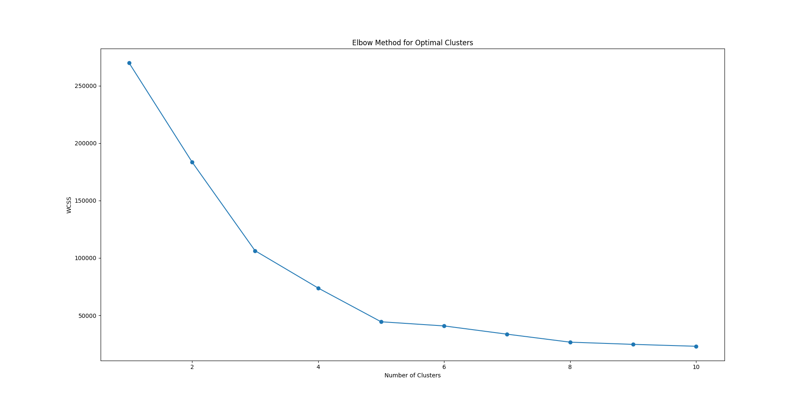
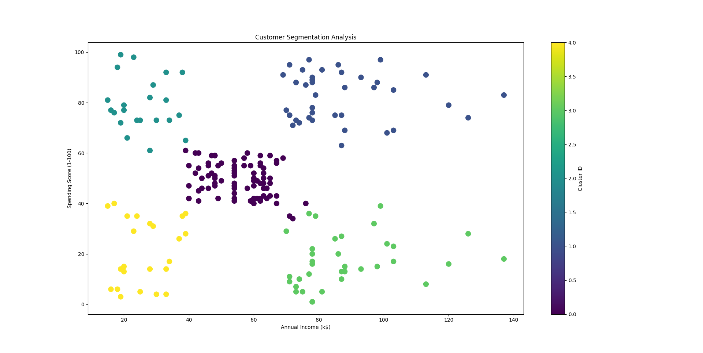
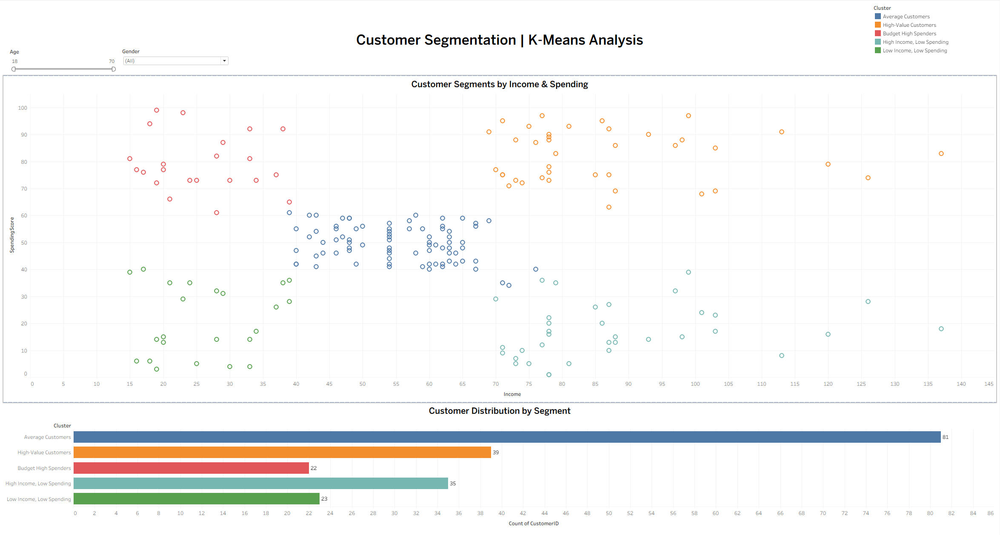

# Customer Segmentation Analysis | Python & Tableau

## Project Overview

This project analyzes customer purchasing behavior using K-Means clustering to identify distinct customer segments based on annual income and spending score.

The analysis was performed in Python, while Tableau was used to create an interactive dashboard for exploring customer groups and their characteristics.

The dataset contains 200 customers, divided into five segments.

## Objectives

- Analyze customer income and spending patterns.
- Identify customer segments using K-Means clustering.
- Determine the appropriate number of clusters using the Elbow Method and Silhouette Score.
- Compare the characteristics of each customer segment.
- Build an interactive Tableau dashboard.
- Identify potential opportunities for targeted marketing.

## Tools and Technologies

- Python
- Pandas
- Matplotlib
- Scikit-learn
- Tableau
- GitHub

## Dataset

The dataset contains 200 customer records with the following fields:

| Column | Description |
|---|---|
| CustomerID | Unique customer identifier |
| Gender | Customer gender |
| Age | Customer age |
| Income | Annual income in thousands of dollars |
| SpendingScore | Customer spending score from 1 to 100 |

Income and SpendingScore were used as the input features for the clustering model.

## Data Preparation

The dataset was imported and processed using Pandas.

The preparation process included:

- Renaming columns for consistency.
- Checking for missing values.
- Checking for duplicate customer IDs.
- Reviewing data types.
- Selecting the features used for clustering.

The dataset contained no missing values or duplicate customer IDs.

## Clustering Methodology

### Elbow Method

The Elbow Method was applied to evaluate cluster counts from 1 to 10.

Within-Cluster Sum of Squares (WCSS) was calculated for each value of K to assess how clustering performance changed as the number of clusters increased.



### Silhouette Score

Silhouette Scores were calculated to evaluate cluster separation.

| Number of Clusters | Silhouette Score |
|---|---|
| 2 | 0.3956 |
| 3 | 0.4676 |
| 4 | 0.4938 |
| 5 | 0.5539 |
| 6 | 0.5128 |
| 7 | 0.5017 |
| 8 | 0.4963 |
| 9 | 0.4559 |
| 10 | 0.4426 |

Five clusters produced the highest Silhouette Score among the tested values.

Based on the Elbow Method and Silhouette Score results, K=5 was selected for the final model.

### K-Means Clustering

The final K-Means model was implemented using Scikit-learn with the following parameters:

- Number of clusters: 5
- Initialization method: k-means++
- Random state: 42

Each customer was assigned a cluster ID based on income and spending score.



## Customer Segmentation Results

The model identified five customer segments.

| Customer Segment | Customers | Percentage | Average Income (k$) | Average Spending Score |
|---|---:|---:|---:|---:|
| Average Customers | 81 | 40.5% | 55.30 | 49.52 |
| High-Value Customers | 39 | 19.5% | 86.54 | 82.13 |
| Budget High Spenders | 22 | 11.0% | 25.73 | 79.36 |
| High Income, Low Spending | 35 | 17.5% | 88.20 | 17.11 |
| Low Income, Low Spending | 23 | 11.5% | 26.30 | 20.91 |
| **Total** | **200** | **100%** | | |

## Key Findings

**Average Customers**

This is the largest segment, representing 40.5% of the customer base. Customers in this group have moderate income and spending scores.

**High-Value Customers**

This segment contains 39 customers with high average income and spending scores. It represents a potential target for premium products and loyalty programs.

**Budget High Spenders**

These 22 customers have relatively low incomes but high spending scores. They may respond well to targeted promotions and loyalty incentives.

**High Income, Low Spending**

This segment includes 35 customers with high incomes but relatively low spending scores. Further analysis could help identify opportunities to increase engagement.

**Low Income, Low Spending**

These 23 customers have low average income and spending scores. Lower-cost marketing campaigns may be more appropriate for this group.

## Business Recommendations

Based on the segmentation results, the following approaches could be tested:

- **Average Customers:** Cross-selling campaigns and personalized product recommendations.
- **High-Value Customers:** Loyalty programs, exclusive offers, and premium product recommendations.
- **Budget High Spenders:** Discounts, reward programs, and value-focused promotions.
- **High Income, Low Spending:** Targeted campaigns to improve engagement and encourage purchases.
- **Low Income, Low Spending:** Automated marketing campaigns with limited acquisition costs.

These recommendations are based on customer characteristics and would require further testing to evaluate their effectiveness.

## Tableau Dashboard

An interactive Tableau dashboard was developed to present the clustering results.

The dashboard includes:

- Customer segmentation by annual income and spending score.
- Customer distribution across the five segments.
- Age and gender filters.
- Color-coded customer segments.



[View Interactive Tableau Dashboard](https://public.tableau.com/views/Customer_Segmentation_Analysis_17739396103910/Dashboard1?:language=en-US&:sid=&:redirect=auth&:display_count=n&:origin=viz_share_link)

## Project Structure

```text
Customer-Segmentation-Python-Tableau/
├── 01_Data/
│   ├── raw_customers.csv
│   └── cleaned_customers.csv
├── 02_Python/
│   └── segmentation.py
├── 03_Tableau/
│   └── Customer_Segmentation_Analysis.twbx
├── 04_Screenshots/
│   ├── 01_Final_Dashboard.png
│   ├── 02_Elbow_Method_Analysis.png
│   ├── 03_Data_Clustering_Logic.png
│   └── 04_python_cleaned_data_preview.png
└── README.md
```


## How to Run the Analysis

Install the required Python libraries:

```bash
pip install pandas matplotlib scikit-learn
```

Navigate to the Python directory:

```bash
cd 02_Python
```

Run the analysis:

```bash
python segmentation.py
```

The script performs data quality checks, evaluates K-Means clustering, generates visualizations, and exports the processed dataset to `01_Data/cleaned_customers.csv`.
  

## Conclusion

The analysis identified five customer segments with different income and spending patterns.

The combination of Python, K-Means clustering, and Tableau provides a practical example of using machine learning and data visualization to support customer analysis and marketing decisions.

The results are based on a small dataset and two clustering features. Additional transaction data and customer behavior metrics would be needed for more detailed segmentation.
